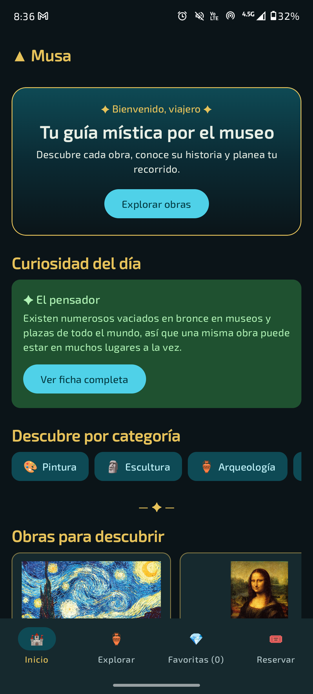
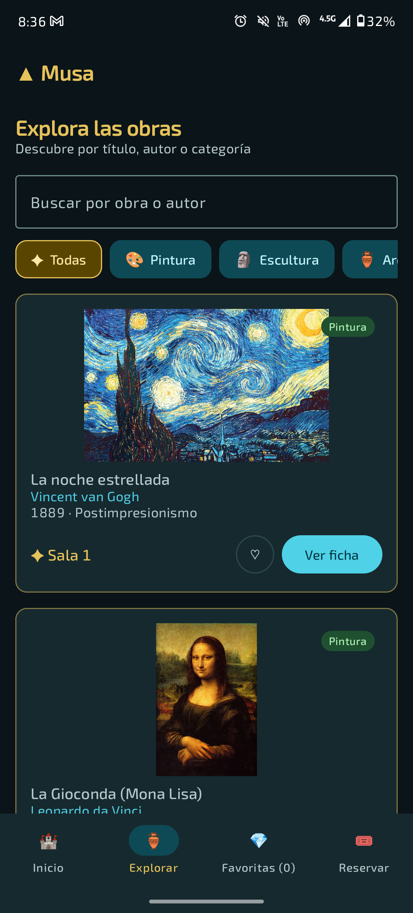
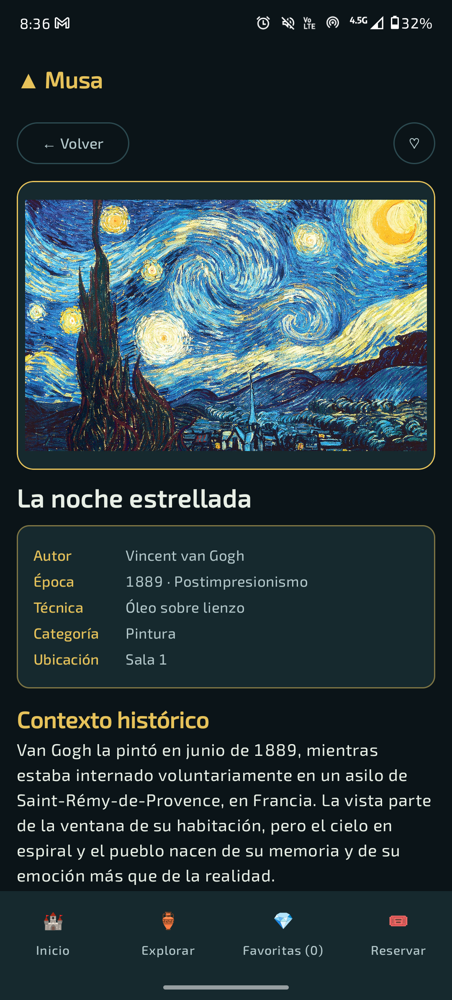
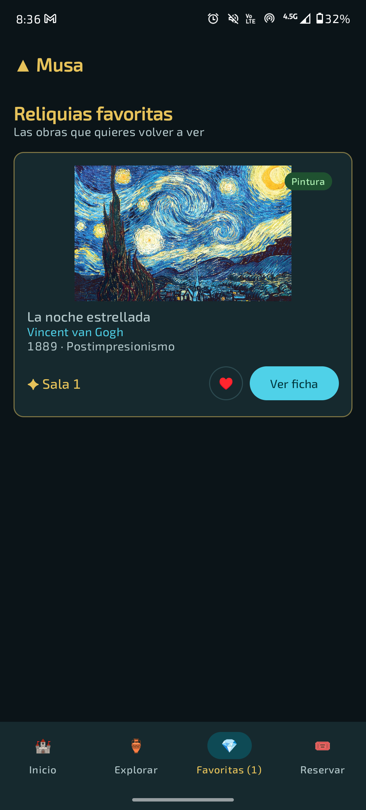
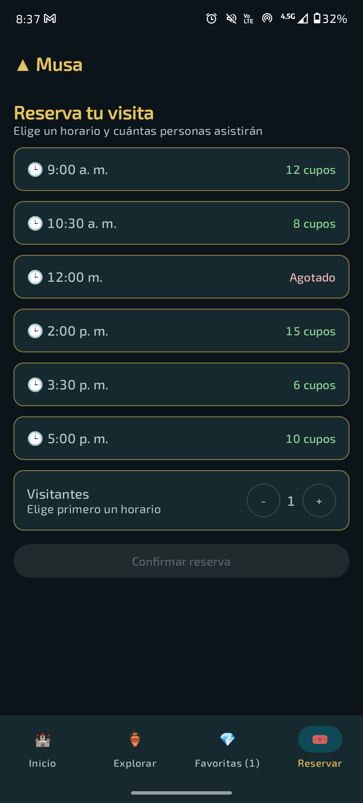
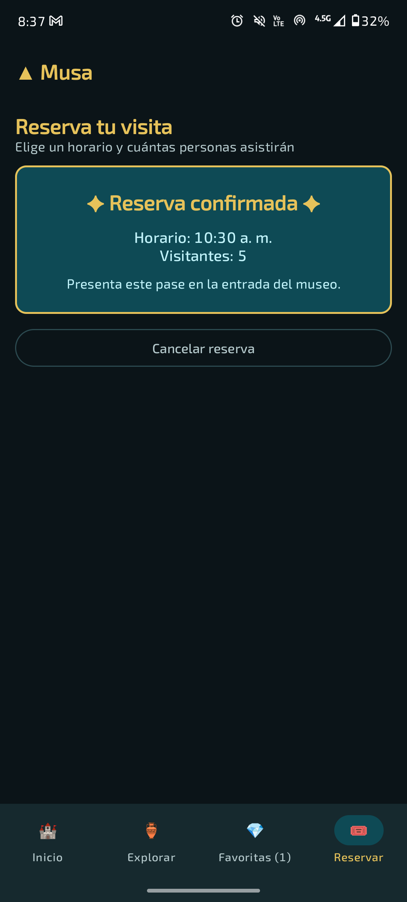

# ▲ Musa · Tu guía mística por el museo

Aplicación móvil para Android desarrollada con **Kotlin** y **Jetpack Compose** como proyecto de la asignatura *Aplicativos Móviles*.

## 1. Negocio

**Musa** es un museo que reúne pintura, escultura y arqueología del mundo. Su identidad visual es mística e inspirada en la estética de fantasía de *The Legend of Zelda*: piedra de templo, azul Sheikah, oro antiguo y tipografía con serif.

## 2. Objetivo de la aplicación

Mejorar la experiencia del visitante, facilitando el descubrimiento, la comprensión y la exploración de las obras y exposiciones. La app no es solo un catálogo digital: funciona como un **acompañante interactivo durante la visita**.

El visitante puede:

- Descubrir las obras por categorías.
- Consultar fotografías e información como autor, época, técnica y contexto histórico.
- Leer curiosidades y datos interesantes de cada obra.
- Guardar sus obras favoritas.
- Reservar su visita en un horario específico.
- Crear un perfil, iniciar sesión o ingresar como invitado.
- Diseñar recorridos personalizados por las obras del museo.

## 3. Pantallas

La navegación se implementa con **Navigation Compose** (`NavController` y `NavHost`) y una barra inferior de cinco pestañas, más una ficha de detalle.

| Pantalla | Propósito |
|---|---|
| **Inicio** | Bienvenida, curiosidad del día, categorías tocables y carrusel de obras. Muestra la reserva confirmada si existe. |
| **Explorar** | Lista de obras con buscador por título o autor y filtro por categoría. |
| **Favoritas** | Obras marcadas con ♥ por el perfil activo. |
| **Mi ruta** | Creación, consulta, edición, archivado y eliminación de recorridos personalizados. |
| **Reservar** | Selección de horario con cupos, número de visitantes y pase de confirmación. |
| **Ficha de la obra** | Fotografía, autor, época, técnica, categoría, ubicación, contexto histórico y curiosidad. |

## 4. Funcionalidades interactivas

### Perfiles y sesiones

La aplicación permite crear usuarios con nombre, usuario y contraseña, iniciar sesión con credenciales existentes o ingresar como invitado. Favoritos, rutas y reservas se relacionan con el perfil activo mediante `userId`, por lo que cada usuario consulta sus propios datos.

### Funcionalidad trabajada en clase

**Búsqueda y cantidades (visitantes).**
- En *Explorar*, el visitante busca obras por título o autor y la lista se filtra en tiempo real.
- En *Reservar*, aumenta y disminuye la cantidad de visitantes con los botones **+** y **-**. El máximo depende de los cupos del horario elegido.
- La reserva confirmada se muestra en otra pantalla (*Inicio*).

### Funcionalidades nuevas

**1. Reliquias favoritas.**
Cada obra tiene un botón ♡ / ♥ que la agrega o la quita de favoritos. El estado se guarda en Room y las obras aparecen en *Favoritas*. El contador se actualiza en la barra inferior.

**2. Filtrar por categorías.**
Chips seleccionables (Pintura, Escultura, Arqueología y Cultura popular, además de "Todas") filtran las obras por categoría. Se combinan con la búsqueda por texto. Las categorías del *Inicio* también llevan directamente a *Explorar* con el filtro aplicado.

**3. Reservas con cupos globales.**

Las reservas pertenecen a cada usuario, pero los cupos se descuentan globalmente para evitar que dos perfiles ocupen el mismo cupo. Cancelar una reserva libera la disponibilidad.

**4. Mi ruta.**

Permite crear recorridos con nombre, modo (*Esencia*, *Contrastes* o *Tiempo*) y obras asociadas. Las obras se seleccionan en miniCards verticales con imagen, nombre y checkbox. Las rutas se pueden consultar, editar, archivar, buscar y eliminar.

**5. Estadísticas e historial.**

La pestaña *Mi ruta* muestra rutas activas, rutas archivadas y visitas confirmadas. También permite alternar entre rutas activas e historial y buscar por nombre, modo u obra.

### Extra: reserva por horarios

El visitante elige un horario con cupos disponibles (hay uno agotado), define cuántas personas asistirán y confirma. La app muestra un pase de reserva que puede cancelarse.

## 5. Capturas de pantalla

| Inicio | Explorar | Ficha de la obra |
|:---:|:---:|:---:|
|  |  |  |

| Favoritas | Reservar | Reserva confirmada |
|:---:|:---:|:---:|
|  |  |  |

## 6. Arquitectura y conceptos aplicados

- **MVVM:** la UI observa estados desde `MuseoViewModel`; las operaciones no acceden directamente a Room.
- **Repository pattern:** `MuseoRepository` centraliza las operaciones de datos.
- **Room:** entidades, DAO, base de datos y migraciones para usuarios, favoritos, reservas y rutas.
- **StateFlow y Flow:** observación reactiva de sesión, datos por usuario y cupos globales.

- **Layouts y modificadores:** `Column`, `Row`, `Box`, `Spacer`, `padding`, `fillMaxWidth`, entre otros.
- **Material 3:** `Scaffold`, `TopAppBar`, `NavigationBar`, `Card`, `Button`, `OutlinedButton`, `OutlinedTextField`.
- **Listas dinámicas:** `LazyColumn` y `LazyRow`, generadas a partir de colecciones de datos.
- **Data classes:** `Obra`, `Category`, `Horario` y entidades Room.
- **Composables reutilizables:** `ArtworkSelectorCard`, `ObraCard`, `FeaturedCard`, `CategoryBadge`, `QuantitySelector`, `FavoriteButton`, `InfoRow` y `HorarioCard`.
- **Estado y eventos:** estado de sesión y datos persistentes en el ViewModel; estado de formulario local en Compose.
- **Tema personalizado:** `Color.kt`, `Theme.kt` y `Type.kt`.

## 7. Estructura del proyecto

```
app/src/main/java/com/example/myapplication/
├── MainActivity.kt              # Coordinación de Compose y navegación
├── Routes.kt                    # Rutas de navegación
├── model/                       # Modelos de dominio
├── data/
│   ├── local/                   # Room: entidades, DAO, base de datos y migraciones
│   ├── repository/              # Acceso centralizado a datos
│   └── MuseumData.kt            # Datos iniciales del museo
├── viewmodel/
│   └── MuseoViewModel.kt        # Sesión, favoritos, reservas y rutas
└── ui/
    ├── components/              # Componentes reutilizables
    ├── screens/                 # Pantallas desacopladas
    └── theme/
        ├── Color.kt             # Paleta Sheikah, oro y verde
        ├── Theme.kt             # Esquemas claro y oscuro de Material 3
        └── Type.kt              # Tipografía con serifa
```

## 8. Cómo ejecutar el proyecto

1. Clona el repositorio:
   ```bash
   git clone <URL-DEL-REPOSITORIO>
   ```
2. Abre la carpeta del proyecto con **Android Studio**.
3. Espera a que Gradle sincronice las dependencias.
4. Verifica que las imágenes de las obras estén en `app/src/main/res/drawable`.
5. Selecciona un emulador o conecta un dispositivo Android.
6. Pulsa **Run ▶**.

La aplicación utiliza Room para almacenar usuarios, favoritos, reservas y rutas. No requiere API externa ni conexión a internet para probar las funcionalidades principales.

### Prueba rápida de perfiles

1. Crea el usuario A y guarda una favorita y una ruta.
2. Cierra sesión desde `Salir`.
3. Crea el usuario B.
4. Comprueba que sus favoritos y rutas estén vacíos e independientes.
5. Reserva un horario con el usuario B y verifica los cupos desde otro perfil.

## 9. Autor

- **Nombre:** Emmanuel Parra Ocampo
- **Asignatura:** Desarrollo de Aplicativos Móviles
- **Tecnología:** Kotlin y Jetpack Compose
