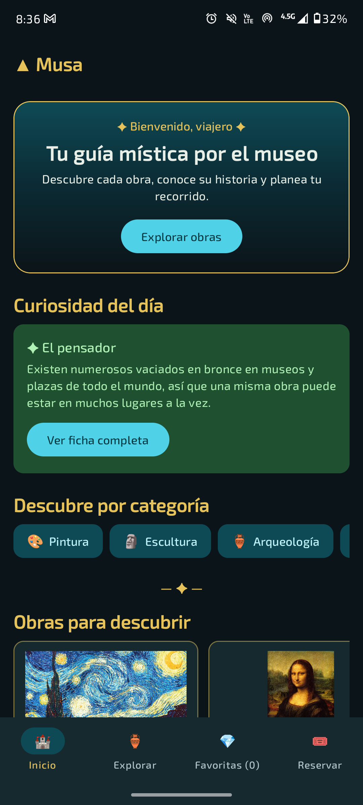
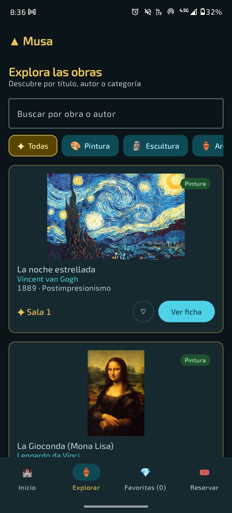
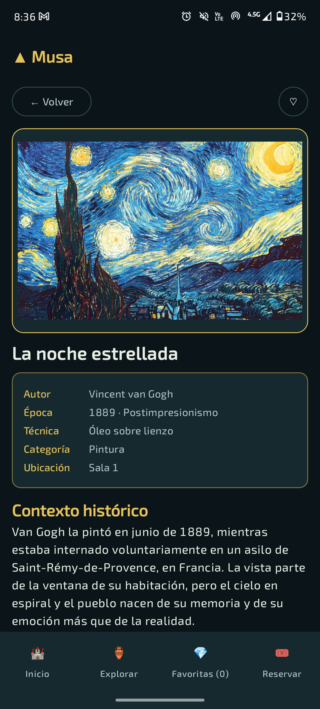
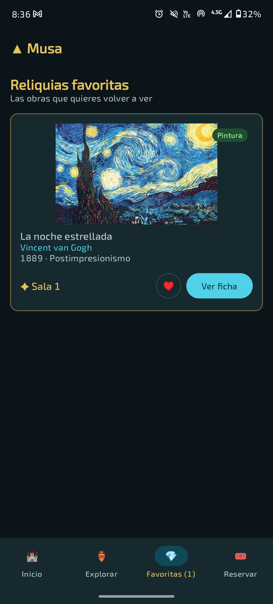
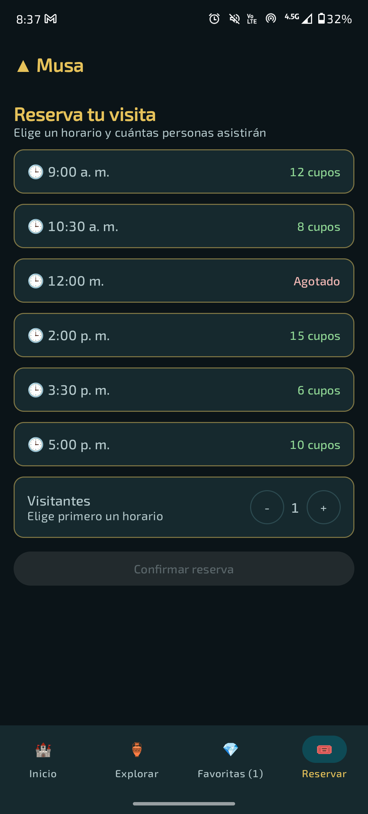
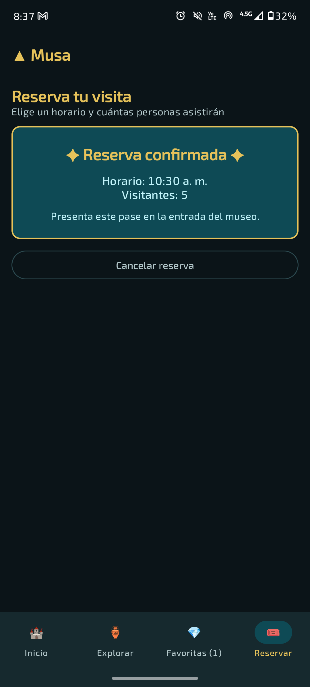

# ▲ Musa · Tu guía mística por el museo

Aplicación móvil para Android desarrollada con **Kotlin** y **Jetpack Compose** como proyecto de la asignatura *Aplicativos Móviles*.

## 1. Negocio

**Musa** es un museo que reúne pintura, escultura y arqueología del mundo. Su identidad visual es mística e inspirada en la estética de fantasía de *The Legend of Zelda*: piedra de templo, azul Sheikah, oro antiguo y tipografía con serif.

## 2. Objetivo de la aplicación

Mejorar la experiencia del visitante, facilitando el descubrimiento, la comprensión y la exploración de las obras y exposiciones. La app no es solo un catálogo digital: funciona como un **acompañante interactivo durante la visita**.

El visitante puede:

- Descubrir las obras por categorías.
- Consultar fotografías e información como autor, época, técnica y contexto histórico.
- Leer curiosidades y datos interesantes de cada obra.
- Guardar sus obras favoritas.
- Reservar su visita en un horario específico.

## 3. Pantallas

La navegación se implementa con **Navigation Compose** (`NavController` y `NavHost`) y una barra inferior de cuatro pestañas, más una ficha de detalle.

| Pantalla | Propósito |
|---|---|
| **Inicio** | Bienvenida, curiosidad del día, categorías tocables y carrusel de obras. Muestra la reserva confirmada si existe. |
| **Explorar** | Lista de obras con buscador por título o autor y filtro por categoría. |
| **Favoritas** | Obras marcadas con ♥ por el visitante. |
| **Reservar** | Selección de horario con cupos, número de visitantes y pase de confirmación. |
| **Ficha de la obra** | Fotografía, autor, época, técnica, categoría, ubicación, contexto histórico y curiosidad. |

## 4. Funcionalidades interactivas

### Funcionalidad trabajada en clase

**Búsqueda y cantidades (visitantes).**
- En *Explorar*, el visitante busca obras por título o autor y la lista se filtra en tiempo real.
- En *Reservar*, aumenta y disminuye la cantidad de visitantes con los botones **+** y **-**. El máximo depende de los cupos del horario elegido.
- La reserva confirmada se muestra en otra pantalla (*Inicio*).

### Funcionalidades nuevas

**1. Reliquias favoritas.**
Cada obra tiene un botón ♡ / ♥ que la agrega o la quita de favoritos. El estado se guarda en un conjunto de identificadores. Las obras favoritas aparecen en la pestaña *Favoritas*, y el contador se actualiza en la barra inferior.

**2. Filtrar por categorías.**
Chips seleccionables (Pintura, Escultura, Arqueología y Cultura popular, además de "Todas") filtran las obras por categoría. Se combinan con la búsqueda por texto. Las categorías del *Inicio* también llevan directamente a *Explorar* con el filtro aplicado.

### Extra: reserva por horarios

El visitante elige un horario con cupos disponibles (hay uno agotado), define cuántas personas asistirán y confirma. La app muestra un pase de reserva que puede cancelarse.

## 5. Capturas de pantalla

> Reemplaza estas rutas por tus capturas (carpeta `docs/screenshots/`).

| Inicio | Explorar | Ficha de la obra |
|:---:|:---:|:---:|
|  |  |  |

| Favoritas | Reservar | Reserva confirmada |
|:---:|:---:|:---:|
|  |  |  |

## 6. Conceptos aplicados

- **Layouts y modificadores:** `Column`, `Row`, `Box`, `Spacer`, `padding`, `fillMaxWidth`, entre otros.
- **Material 3:** `Scaffold`, `TopAppBar`, `NavigationBar`, `Card`, `Button`, `OutlinedButton`, `OutlinedTextField`.
- **Listas dinámicas:** `LazyColumn` y `LazyRow`, generadas a partir de colecciones de datos.
- **Data classes:** `Obra`, `Category` y `Horario`.
- **Composables reutilizables:** `ObraCard`, `FeaturedCard`, `CategoryBadge`, `QuantitySelector`, `FavoriteButton`, `InfoRow`, `HorarioCard`, entre otros.
- **Estado y eventos:** `remember` y `mutableStateOf`, con el estado elevado a `MuseoApp` y pasado a cada pantalla mediante parámetros y lambdas.
- **Tema personalizado:** `Color.kt`, `Theme.kt` y `Type.kt`.

## 7. Estructura del proyecto

```
app/src/main/java/com/example/myapplication/
├── MainActivity.kt      # Pantallas, componentes y navegación
└── ui/theme/
    ├── Color.kt         # Paleta Sheikah, oro y verde
    ├── Theme.kt         # Esquemas claro y oscuro de Material 3
    └── Type.kt          # Tipografía con serifa
```

## 8. Cómo ejecutar el proyecto

1. Clona el repositorio:
   ```bash
   git clone <URL-DEL-REPOSITORIO>
   ```
2. Abre la carpeta del proyecto con **Android Studio**.
3. Espera a que Gradle sincronice las dependencias.
4. Verifica que las imágenes de las obras estén en `app/src/main/res/drawable`.
5. Selecciona un emulador o conecta un dispositivo Android.
6. Pulsa **Run ▶**.

No requiere base de datos, API ni cuenta de usuario: todos los datos son locales.

## 9. Autor

- **Nombre:** Emmanuel Parra Ocampo
- **Asignatura:** Desarrollo de Aplicativos Móviles
- **Tecnología:** Kotlin y Jetpack Compose
